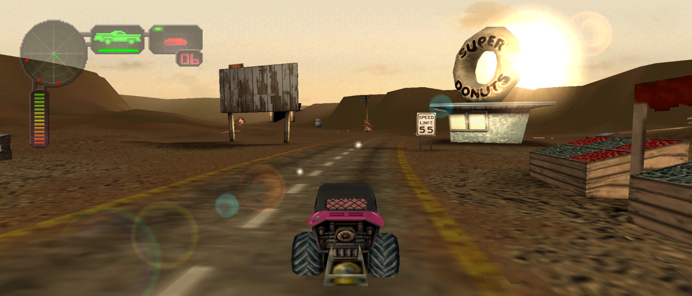
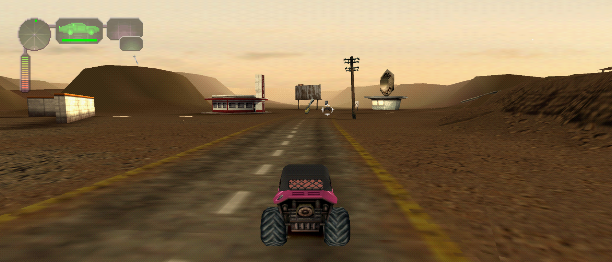
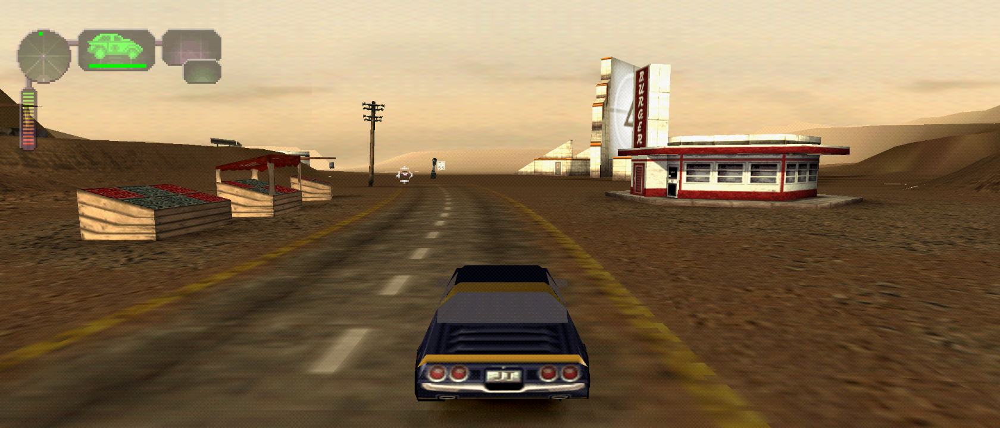

# Vigilante 8: 2nd Offense

Vehicular combat on PC, with wide arenas, sharper rendering and two-player
netplay where **each player gets their own full-screen view**.

**[Download v0.4.0 for Windows](https://github.com/mstan/Vigilante82PSXRecomp/releases/tag/v0.4.0)**

Bring your own USA PlayStation disc. No game data is included.

*Real 21:9 gameplay at 4x internal resolution.*

## What's included

- **Vigilante 8: 2nd Offense on PC**, with its retail cars, arenas and game modes.
- **Widescreen enabled by default.** Fit to Window follows your display; fixed
  16:9, 21:9 and 32:9 views are also available. Gameplay reveals more of the
  arena, while menus and movies keep their original layout.
- **4x internal resolution by default**, with PGXP geometry correction and
  adjustable visual options in the launcher.
- **Two-player rollback netplay**, with a separate full-screen camera for each
  player at 16:9 or 21:9. Local two-player split-screen is also available.
- **Optional original Vigilante 8 cars and music**, plus Super Dreamland 64
  from the N64 game, using your own original media.
- **Gamepad setup, save states and mods** in the shared launcher.

## Quick start

1. Extract the entire Windows ZIP and run **Vigilante82PSXRecomp.exe**.
2. Select your complete **Vigilante 8: 2nd Offense USA** disc (`SLUS-00868`).
   Offline play supports CUE/BIN and CHD. For netplay, select the complete
   17-track **.cue** and keep every track BIN beside it.
3. Configure your controller and press **Play**. OpenBIOS is included, so no
   retail BIOS file is needed.

Keep your saves and settings when updating. Explicitly saved mod and view
choices remain yours; fresh defaults do not overwrite them.

## Controllers

Configure your gamepad or keyboard in the launcher. For local two-player games,
configure **Player 1** and **Player 2**. For netplay, each computer configures its
own controller under **Player 1 / Netplay**. Controls follow the original
PlayStation game and can be remapped.

## Netplay: one screen per player

Both players need **the same release**, the complete 17-track sequel CUE/BIN and matching
content/mod choices. Each player supplies and verifies their own media.

1. Select **16:9** or **21:9** under **Mods → Widescreen → View** before starting.
   Netplay keeps that aspect for the match; Fit to Window uses 16:9 online.
2. Open **Netplay** and host or join a room, or choose **LAN / Direct IP**.
3. Start the match, then choose **2 Player** and the game mode you want.

Each peer sees their own car, camera and HUD across the full gameplay view.
Selection, pause and confirmation menus retain their complete original layout.
The showcase images use a live LAN / Direct IP match.

**Player 1: Wonderwagon**

**Player 2: Thunderbolt, in the same match**

## Optional original-game content

| Content | Your source media |
|---|---|
| Thirteen original Vigilante 8 cars and the original soundtrack | Vigilante 8 USA PlayStation disc, version 1.0 |
| Super Dreamland 64 | Vigilante 8 USA N64 ROM |

Select source media in **Mods** and enable the content you want. Preparation is
automatic; no Python installation or manual extraction is needed. Netplay
players each prepare their own copies. Donor assets are not transferred between
players. Quest keeps its retail roster; imported campaigns are not included.

## More information

High Frame Rate is an optional experimental mod. Optional imports have limited
playtest coverage; the complete roster, arenas and campaigns have not all been
qualified. See the validation notes below for scope. Save states belong to the
build that created them; keep native memory-card saves for persistent progress.

- [Release notes and known limitations](RELEASE_NOTES.md)
- [Gameplay and netplay validation](https://github.com/mstan/Vigilante82PSXRecomp/blob/main/docs/PLAYTEST.md)
- [Building and packaging from source](https://github.com/mstan/Vigilante82PSXRecomp/blob/main/docs/BUILD_RELEASE.md)
- [Licensing and credits](LICENSING.md)

Built on [psxrecomp](https://github.com/RetroPortingToolKit/psxrecomp) and
[recomp-ui](https://github.com/RetroPortingToolKit/recomp-ui), with rollback
networking from [recomp-net](https://github.com/RetroPortingToolKit/recomp-net)
and combined
content work adapted from the authorized
[Vigilante 8 reference implementation](https://github.com/GTTeancum/Vigilante-8-recomp).
